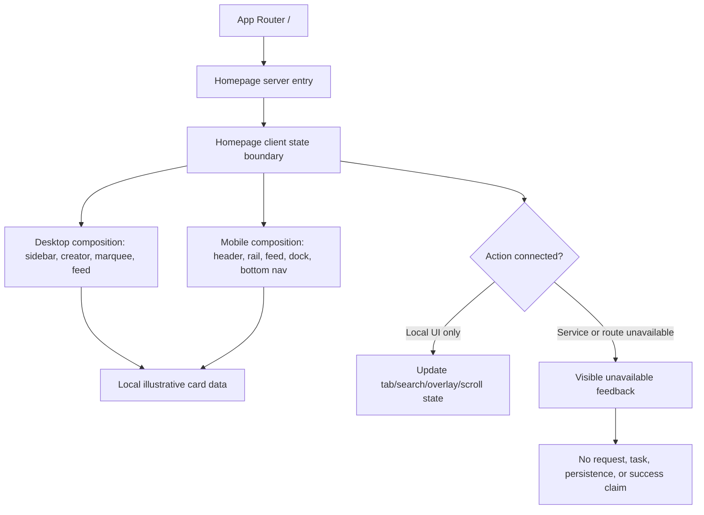

# Phase 02: Implement Stitch homepage (desktop and mobile) - Research

**Researched:** 2026-11-14  
**Domain:** Next.js App Router homepage implementation; separate desktop and mobile responsive interfaces  
**Confidence:** HIGH for phase boundaries and design contract; MEDIUM for browser-specific soft-keyboard behavior that requires device verification.

<user_constraints>

## User Constraints (from CONTEXT.md)

### Locked Decisions

### Source of truth and composition

- Follow desktop Stitch screen `11739032930266818070` and HTML `11065783241239000542` for desktop.
- Follow mobile Stitch screen `be1747efb4544717b4a1ac2b403cd297` and HTML `9878290599392228766` for mobile.
- The mobile screen is intentionally distinct; do not shrink the desktop layout into a phone viewport.
- The exported desktop raster is corrupted; compare with the source screen, HTML, and actual page rendering instead of reproducing its artifacts.

### Responsive layout and visual contract

- Keep the desktop liquid-glass navigation/creator/feed composition from Stitch.
- Keep the mobile compact account header, feature exploration, inspiration feed, floating prompt dock, and bottom navigation from its dedicated Stitch design.
- Verify 375, 390, 768, 1280, and 1440px widths with safe-area and fixed-layer clearance.

### Interaction and service boundaries

- Implement the page-visible navigation, mode/model/type switching, search, scrolling, modal, and prompt-dock interactions.
- Provide visible focus and accessible names/labels; touch and keyboard both operate key controls.
- Unconnected actions give a clear unavailable/placeholder response; no real API, generation job, remote account mutation, or false success is introduced.
- Use the existing Next.js/React/TypeScript/Tailwind stack. No shadcn initialization or new UI dependency is needed to reproduce the supplied design.
- Preserve other worktree changes; do not touch the backend repository or perform remote Git operations.

### the agent's Discretion

- Choose component/file boundaries and responsive breakpoints consistent with the supplied source and existing project conventions.
- Use a small local sample dataset matching the visible Stitch cards; keep it explicitly illustrative.
- Reuse/design local tokens in CSS; avoid adding a component framework for this one page.

### Deferred Ideas (OUT OF SCOPE)

- Real authentication, server persistence, project/asset APIs, AIGC provider calls, and task progress.
- Full editor, canvas, 3D director, Agent execution, and all non-homepage routes.
- Push, merge, and production deployment.
  </user_constraints>

<phase_requirements>

## Phase Requirements

| ID                    | Description                                                                           | Research Support                                                                             |
| --------------------- | ------------------------------------------------------------------------------------- | -------------------------------------------------------------------------------------------- |
| HOME-01               | Desktop Stitch homepage: navigation, creator, marquee, inspiration feed, glass visual | Separate desktop shell, reusable primitives, and desktop-only composition plan.              |
| HOME-02               | Dedicated mobile page and expandable/collapsible prompt dock                          | Mobile-only structure, focus lifecycle, safe-area and soft-keyboard verification plan.       |
| HOME-03               | Working in-page controls and honest unavailable feedback                              | Local reducer/state ownership and one truthful unavailable-feedback mechanism.               |
| HOME-04               | No overflow, clipping, or fixed-layer collision at five required widths               | Explicit breakpoint matrix, `min-width: 0`, content bottom clearance, and screenshot matrix. |
| HOME-05               | Named controls, labels, focus, keyboard/touch overlay operation                       | Semantic-control and focus-return checklist.                                                 |
| HOME-06               | Screenshots, deviation log, and startup guidance                                      | Browser evidence and `docs/verification-homepage.md` plan.                                   |
| </phase_requirements> |

## Project Constraints (from AGENTS.md)

- Read planning state/requirements/plans before development; distinguish completed, unconnected, and pending work. [VERIFIED: AGENTS.md:5]
- Linear is written only by Hermes; Codex returns task evidence in `.planning/events.jsonl` and must not bypass a rejected MCP write. [VERIFIED: AGENTS.md:6]
- The supplied Stitch/approved design is required before product-page implementation; the source is now present. [VERIFIED: AGENTS.md:7]
- No guessed API URL or fabricated success; only approved OpenAPI may drive a real API. [VERIFIED: AGENTS.md:8]
- Preserve strict types/state layering and do not import canvas/3D from an ordinary route. [VERIFIED: AGENTS.md:9-10]
- Phase completion must run `npm run check` and `npm run build`; do not commit secrets, push, merge, deploy, alter the backend repository, or create a remote. [VERIFIED: AGENTS.md:11-12]

## Summary

Implement the homepage by replacing the empty App Router root with an intentionally local, stateful homepage client boundary and CSS tokens. The current root is explicitly empty, the global stylesheet contains only the Tailwind import, while the root layout already establishes `lang="zh-CN"` and the shared provider. This permits a focused homepage implementation without changing routing, service ports, or the 3D/canvas modules. [VERIFIED: src/app/page.tsx:1-4; src/app/globals.css:5-7; src/app/layout.tsx:13-22]

Treat the two Stitch exports as separate compositions sharing only data and small presentational primitives: desktop owns the sidebar/sticky creator/workspace flow; mobile owns its compact header, two-column feed, fixed bottom navigation, and expandable dock. The supplied specification requires precisely that separation and forbids raw exported HTML/inline event handlers. [VERIFIED: SPEC.md:15-23,34-39; 02-UI-SPEC.md:28-39]

**Primary recommendation:** Build a local `HomepageClient` with desktop and mobile composition components, a typed illustrative-card dataset, semantic native controls, and a single in-page unavailable-feedback state; add CSS token and breakpoint layers rather than dependencies or backend integration. [VERIFIED: 02-CONTEXT.md:28-38; 02-UI-SPEC.md:18-24]

## Architectural Responsibility Map

| Capability                                                                        | Primary Tier          | Secondary Tier           | Rationale                                                                                                                                                                                                                                      |
| --------------------------------------------------------------------------------- | --------------------- | ------------------------ | ---------------------------------------------------------------------------------------------------------------------------------------------------------------------------------------------------------------------------------------------- |
| Desktop homepage shell, local selection/search state, and modal/dock interactions | Browser / Client      | —                        | The phase is a routed visual UI with browser-only interaction; no server data is in scope. [VERIFIED: SPEC.md:21-23,36-39]                                                                                                                     |
| Route entry and document language/metadata                                        | Frontend Server (SSR) | Browser / Client         | Retain App Router root layout; mount client behavior below it. [VERIFIED: src/app/layout.tsx:8-22]                                                                                                                                             |
| Inspiration-card sample data                                                      | Browser / Client      | —                        | The decision calls for a small explicitly illustrative local dataset, not remote persistence. [VERIFIED: 02-CONTEXT.md:35-38; SPEC.md:38-39]                                                                                                   |
| Generation, account changes, destination routing, and task persistence            | —                     | API / Backend (deferred) | These must remain placeholders because this phase authorizes neither API calls nor claims of success. [VERIFIED: SPEC.md:21-23,38-39]                                                                                                          |
| Image/font delivery                                                               | CDN / Static          | Browser / Client         | Production rendering must not silently depend on Stitch's external hotlinks; resolved assets require an approved static strategy. [VERIFIED: /opt/data/cache/scratch/car5-desktop.html:6,220; /opt/data/cache/scratch/car5-mobile.html:1-2,24] |

## Standard Stack

### Core

| Library           |  Version | Purpose                                               | Why Standard                                                                                                                             |
| ----------------- | -------: | ----------------------------------------------------- | ---------------------------------------------------------------------------------------------------------------------------------------- |
| Next.js           | `16.4.6` | Existing App Router route and build                   | Already installed and the root route/layout are established. [VERIFIED: package.json:25; src/app/page.tsx:1-4; src/app/layout.tsx:13-22] |
| React / React DOM | `19.3.1` | Client-local interactive homepage state               | Already installed; UI-SPEC requires browser-only page state in client components. [VERIFIED: package.json:26-27; 02-UI-SPEC.md:24]       |
| Tailwind CSS      |  `4.3.5` | Existing utility baseline, alongside local CSS tokens | Already imported globally and mandated by the approved stack. [VERIFIED: package.json:28; src/app/globals.css:5; SPEC.md:36-37]          |
| TypeScript        |  `6.0.3` | Strict typed local data and UI state                  | Existing project language and explicit project constraint. [VERIFIED: package.json:40; AGENTS.md:10]                                     |

### Supporting

| Existing capability                                        | Purpose                                                                 | When to Use                                                                                                                                   |
| ---------------------------------------------------------- | ----------------------------------------------------------------------- | --------------------------------------------------------------------------------------------------------------------------------------------- |
| Inline SVG                                                 | Local icons without a new dependency                                    | Use accessible `<button>` controls with `aria-label`; decorative SVG is `aria-hidden`. [VERIFIED: 02-UI-SPEC.md:20-21,107-112]                |
| CSS custom properties and media queries                    | Desktop/mobile palettes, spacing, fixed-layer clearance, reduced motion | Define page tokens in global CSS; keep layout variants separate. [VERIFIED: 02-UI-SPEC.md:41-55,70-81,95-105]                                 |
| Native `dialog` or a semantic in-page modal implementation | Settings/announcement surface                                           | Use only when visible; manage focus and Escape close. [VERIFIED: 02-UI-SPEC.md:35,105,111; /opt/data/cache/scratch/car5-desktop.html:773-821] |

**Installation:** None. This phase must not add packages. [VERIFIED: 02-CONTEXT.md:31-32; 02-UI-SPEC.md:135-137]

## Package Legitimacy Audit

Not applicable: no external package is recommended or installed in this phase. [VERIFIED: 02-CONTEXT.md:31-32]

## Architecture Patterns

### System Architecture Diagram



The implementation must keep the “unavailable” branch inside the client UI and must not call the existing generation/account ports, because the specification explicitly excludes remote calls and generated-content claims. [VERIFIED: SPEC.md:21-23,38-39]

### Recommended Project Structure

```text
src/
├── app/page.tsx                         # route entry; mounts the homepage client boundary
├── app/globals.css                      # homepage tokens, responsive layout, motion/focus rules
└── components/homepage/
    ├── homepage-client.tsx              # local UI state and composed page
    ├── desktop-homepage.tsx             # desktop-only shell and creator flow
    ├── mobile-homepage.tsx              # mobile-only header/feed/dock/nav
    ├── inspiration-data.ts               # typed, explicitly illustrative local cards
    └── homepage-primitives.tsx          # reusable cards, buttons, unavailable feedback
```

This is a proposed file split, not a discovered in-repo convention. It enforces the approved separation between independently composed desktop/mobile layouts while preserving shared data/primitives. [ASSUMED]

### State ownership and interaction rules

1. Make the route entry server-compatible and place hooks/event handlers in one `use client` homepage boundary; do not turn the root layout or unrelated service modules into UI state containers. [VERIFIED: SPEC.md:36-37; src/app/layout.tsx:15-20]
2. Keep `activeCategory`, creator mode/type/model, selected ratio, search text, banner visibility, sidebar appearance, settings visibility, dock-expanded state, and unavailable-feedback message local to that boundary. This is a recommended local-state model derived from the listed in-page interactions; it must not use generation/account ports. [ASSUMED]
3. Derive filtered inspiration cards from the local illustrative dataset; render the stated empty copy when zero cards match, and provide a clear-search action. [VERIFIED: 02-UI-SPEC.md:87-90,105,121,130]
4. Use native `<button>` elements for tabs/filters/icon actions and expose selection with `aria-pressed` or the appropriate tab semantics. Every unavailable destination or action must produce the approved informational text, never a fabricated completion. [VERIFIED: 02-UI-SPEC.md:93,105,109-112; SPEC.md:21-23]
5. For the mobile dock: opening records the triggering button, exposes a backdrop and textarea, moves focus into the textarea, closes on Escape/backdrop/close action, then restores focus to the trigger. Keep dock/nav clear using `env(safe-area-inset-bottom)` plus a content-bottom reserve. [VERIFIED: 02-UI-SPEC.md:39,55,99-105,109-112]

### Desktop and mobile are separate responsibilities

| Area                  | Desktop implementation                                                                        | Mobile implementation                                                        | Shared only                                                                              |
| --------------------- | --------------------------------------------------------------------------------------------- | ---------------------------------------------------------------------------- | ---------------------------------------------------------------------------------------- |
| Global shell          | Liquid-glass sidebar, promo strip, sticky category navigation, large creator panel            | Compact header, promo panel, fixed bottom navigation                         | Brand and local data primitives. [VERIFIED: 02-UI-SPEC.md:28-39]                         |
| Explore content       | Workspace marquee + banner + feed in main scroll area                                         | Horizontally scrolling exploration rail + two-column feed                    | Card data and card metadata handling. [VERIFIED: 02-UI-SPEC.md:34,39,99-103]             |
| Creation interaction  | Expanded creator controls; optional floating desktop dock only when it does not cover content | Collapsed prompt pill expands to overlay/dock and is keyboard/touch operable | Unavailable feedback, prompt string (local only). [VERIFIED: 02-UI-SPEC.md:33,39,99-105] |
| Breakpoint transition | Desktop at wide widths; at 768 compact the sidebar rather than render competing fixed systems | Do not leave the mobile bottom nav/dock over the desktop creator at 768      | CSS tokens, focus style, local sample data. [VERIFIED: 02-UI-SPEC.md:101-103]            |

### External asset strategy and risks

- The original HTML imports Tailwind from `cdn.tailwindcss.com`, Google font stylesheets, Material Symbols, and many `lh3.googleusercontent.com/aida-public/...` image URLs. None should be copied into the production page as its runtime build strategy. [VERIFIED: /opt/data/cache/scratch/car5-desktop.html:6,220; /opt/data/cache/scratch/car5-mobile.html:1-2,24]
- `next.config.ts` has no image remote configuration. Do not switch to optimized Next `<Image>` using those remote URLs without an explicitly approved and tested asset policy; that would be a separate configuration decision. [VERIFIED: next.config.ts:47-54]
- Card and banner visuals are locked to self-contained local CSS treatments and inline SVG illustration primitives; do not copy remote Stitch media or add an asset-delivery dependency. Label the cards as illustrative examples, retain fixed media geometry, and never represent a visual fallback as generation progress. [VERIFIED: 02-UI-SPEC.md:20-21,121-124; SPEC.md:38-39]
- Do not pull the exported `<script>` snippets forward: they depend on inline handlers, direct DOM lookups, and a runtime Tailwind CDN, which violates the implementation boundary. [VERIFIED: SPEC.md:34-37; /opt/data/cache/scratch/car5-desktop.html:212,257-375,828-943; /opt/data/cache/scratch/car5-mobile.html:35,51-52]

## Don't Hand-Roll

| Problem                           | Do not build                                      | Use instead                                                              | Why                                                                                                                                                                            |
| --------------------------------- | ------------------------------------------------- | ------------------------------------------------------------------------ | ------------------------------------------------------------------------------------------------------------------------------------------------------------------------------ |
| Generation/task/account execution | Mock API or fake task-ID/success flow             | Single local unavailable-feedback state                                  | The repository explicitly fails closed for unconfigured operations; CAR-5 excludes remote work. [VERIFIED: SPEC.md:21-23,38-39; tests/unconfigured.test.ts:4-29]               |
| Desktop-to-mobile adaptation      | Shrunk desktop sidebar/creator at phone width     | Separate desktop and mobile compositions sharing primitives only         | Mobile order and fixed layers are a distinct approved design. [VERIFIED: 02-CONTEXT.md:18-26; 02-UI-SPEC.md:28-39]                                                             |
| Overlay behavior                  | Unmanaged absolute panel/inline DOM event scripts | Controlled React state with focus lifecycle and semantic controls        | The design contract requires Escape close, focus return, keyboard/touch access, and no clipped focus ring. [VERIFIED: 02-UI-SPEC.md:105-112]                                   |
| Image optimizer/CDN integration   | Ad hoc third-party image loader                   | Approved local assets or clearly labelled fixed-size visual placeholders | The Stitch export is external hotlink data and project configuration has no remote image policy. [VERIFIED: /opt/data/cache/scratch/car5-mobile.html:24; next.config.ts:47-54] |

## Common Pitfalls

### Pitfall 1: Copying the Stitch HTML

**What goes wrong:** Inline `onclick`, `document.getElementById`, CDN Tailwind, and generated class strings are carried into the App Router page.  
**Why it happens:** The exports demonstrate visual intent but are not an application component architecture.  
**How to avoid:** Recreate structures as typed React components with local CSS and React event handlers; preserve only the approved visual/copy/interaction intent.  
**Warning signs:** `onclick=`, `javascript:void(0)`, or `<script>` appear in `src/`. [VERIFIED: SPEC.md:34-37; /opt/data/cache/scratch/car5-desktop.html:212,257-375,828-943]

### Pitfall 2: Fixed layers collide at mobile/tablet widths

**What goes wrong:** The nav, dock, backdrop, content, and soft keyboard overlap, or horizontal rails cause body overflow.  
**Why it happens:** The source relies on multiple fixed/overflow containers, while CAR-5 requires different systems across mobile, tablet, and desktop.  
**How to avoid:** Reserve bottom content space, use safe-area padding, scope rail overflow to its own container, use `min-width: 0` for flex/grid children, and validate every required viewport plus keyboard focus.  
**Warning signs:** `document.documentElement.scrollWidth > window.innerWidth`, hidden focused input, or simultaneous mobile/desktop fixed controls. [VERIFIED: 02-UI-SPEC.md:99-105,126; SPEC.md:27-31]

### Pitfall 3: “Visual-only” controls lie about unavailable services

**What goes wrong:** Start/create, copy, login, or navigation feedback looks like a completed backend task.  
**Why it happens:** The design has production-style CTAs but the phase contains no configured provider, API, auth, or destination route.  
**How to avoid:** Use the exact approved unavailable text and keep successful local feedback limited to tab/filter/search/expand/collapse/scroll state.  
**Warning signs:** Task IDs, “generated/saved” copy, fetch calls, or mutations in the homepage code. [VERIFIED: 02-UI-SPEC.md:87-93; SPEC.md:21-23,38-39]

### Pitfall 4: Accessibility regresses while matching glass visuals

**What goes wrong:** Icon-only targets are too small, focus disappears behind translucent layers, inputs rely only on placeholder text, or the backdrop leaves background controls reachable.  
**How to avoid:** Use named semantic controls, visible 2px focus treatment, 44×44px hit areas, managed dock focus/return, and reduced-motion behavior for the marquee. [VERIFIED: 02-UI-SPEC.md:55,105,107-113]

## Code Examples

No copied source code is recommended. The implementation must translate Stitch interactions into typed React handlers rather than reuse its inline scripts. The state/ownership rules above are the planner's implementation contract. [VERIFIED: SPEC.md:34-37]

## State of the Art

| Rejected source-export practice                                    | Required project practice                                                      | Impact                                                                                                                                                                                                   |
| ------------------------------------------------------------------ | ------------------------------------------------------------------------------ | -------------------------------------------------------------------------------------------------------------------------------------------------------------------------------------------------------- |
| Runtime Tailwind CDN, external-font/image hotlinks, inline scripts | Existing Next/React/Tailwind project with local React components and local CSS | The page builds with the existing project and avoids unreviewed third-party runtime dependencies. [VERIFIED: package.json:20-41; SPEC.md:34-37; /opt/data/cache/scratch/car5-desktop.html:6,212,828-943] |

## Assumptions Log

| #   | Claim                                                                                    | Section               | Risk if Wrong                                                                                           |
| --- | ---------------------------------------------------------------------------------------- | --------------------- | ------------------------------------------------------------------------------------------------------- |
| A1  | The proposed `components/homepage/` file split is suitable for this project.             | Architecture Patterns | Low: planner may choose another local component boundary while preserving desktop/mobile separation.    |
| A2  | The listed interaction fields should be colocated in one homepage client state boundary. | State ownership       | Medium: detailed UX could justify narrower state boundaries, but no service/store should be introduced. |

## Open Questions (RESOLVED)

1. **Illustrative-card visual source — resolved.**
   - Use self-contained local CSS treatments and inline SVG illustration primitives for every card/banner visual. Do not commit, hotlink, optimize, or otherwise deliver the Stitch export's remote Google-hosted media. This preserves the required demonstrative layout without inventing asset permissions or adding an image/CDN dependency. [VERIFIED: 02-UI-SPEC.md:20-21,121-124; SPEC.md:38-39; /opt/data/cache/scratch/car5-mobile.html:24]

2. **Browser/keyboard evidence — resolved with a UAT boundary.**
   - Cached Chromium is available in this container at `/opt/data/home/.cache/ms-playwright/chromium-1247/chrome-linux64/chrome`; use the available Playwright/Chromium workflow for screenshots, keyboard interaction, overflow checks, and a reduced-height `VisualViewport` proxy. [VERIFIED: environment probe, 2026-11-14]
   - Implementation must respond to `VisualViewport` resize/scroll changes while the dock textarea is focused, preserving access to the input and submit control in the browser proxy. [VERIFIED: 02-UI-SPEC.md:99-105]
   - A physical OS soft keyboard/device is unavailable in this container. Browser viewport reduction is evidence for layout behavior only; it is not evidence that a real mobile keyboard passed. The physical-keyboard/safe-area criterion remains a required human/device UAT and must be recorded as pending rather than claimed as passed. [VERIFIED: SPEC.md:27-32; 02-UI-SPEC.md:99-105]

## Environment Availability

| Dependency                                    | Required By                                    |              Available |               Version | Fallback                                                                                                                                                  |
| --------------------------------------------- | ---------------------------------------------- | ---------------------: | --------------------: | --------------------------------------------------------------------------------------------------------------------------------------------------------- |
| Node.js                                       | Next development/build                         |                      ✓ |             `v26.7.0` | Project declares `>=22.12.0`. [VERIFIED: package.json:16-18]                                                                                              |
| npm                                           | Existing scripts                               |                      ✓ |              `12.0.2` | Project declares `>=10`. [VERIFIED: package.json:16-18]                                                                                                   |
| Vitest                                        | Existing non-UI regression suite               | ✓ (project dependency) |               `5.1.0` | Use `npm test`. [VERIFIED: package.json:13,41]                                                                                                            |
| Cached Chromium / Playwright browser workflow | Visual, layout, and keyboard-proxy evidence    |         ✓ in container | Chromium build `1247` | Use it for screenshot/overflow/focus and reduced-height VisualViewport checks; do not add a project dependency. [VERIFIED: environment probe, 2026-11-14] |
| Physical mobile device / OS soft keyboard     | Final physical keyboard and safe-area evidence |         ✗ in container |                     — | Required human/device UAT; record as pending until performed. [VERIFIED: SPEC.md:27-32; 02-UI-SPEC.md:99-105]                                             |

**Missing dependencies with no fallback:** No implementation dependency is missing. A physical mobile keyboard/device is unavailable in this container and has no browser-only substitute for final acceptance; perform human/device UAT. [VERIFIED: SPEC.md:25-32; 02-UI-SPEC.md:99-105]

**Missing dependencies with fallback:** A committed E2E framework is absent, but cached Chromium/Playwright supplies the no-dependency browser verification workflow for visual, focus, overflow, and reduced-height viewport proxy checks. [VERIFIED: environment probe, 2026-11-14; 02-CONTEXT.md:31-32]

## Validation Architecture

### Test Framework

| Property           | Value                                                                        |
| ------------------ | ---------------------------------------------------------------------------- |
| Framework          | Vitest `5.1.0` [VERIFIED: package.json:13,41]                                |
| Config file        | none found; `vitest run` is the package script. [VERIFIED: package.json:13]  |
| Quick run command  | `npm test` [VERIFIED: package.json:13]                                       |
| Full suite command | `npm run check && npm run build` [VERIFIED: package.json:7,14; AGENTS.md:11] |

### Phase Requirements → Test Map

| Req ID  | Behavior                                          | Test Type                                                                                                                  | Automated Command                                                             | File Exists?                         |
| ------- | ------------------------------------------------- | -------------------------------------------------------------------------------------------------------------------------- | ----------------------------------------------------------------------------- | ------------------------------------ |
| HOME-01 | Desktop composition and styling                   | Browser visual comparison at 1280/1440                                                                                     | Manual screenshot + `npm run check && npm run build`                          | ❌ Wave 0 browser record             |
| HOME-02 | Mobile composition and dock toggle                | Cached Chromium: keyboard/touch and reduced-height VisualViewport proxy at 375/390; human/device: physical OS keyboard UAT | Browser screenshot/interaction check; human/device result recorded separately | ❌ Wave 0 browser record + human UAT |
| HOME-03 | Local controls and unavailable messaging          | Unit test for pure filter/state helpers where extracted; browser interaction check                                         | `npm test`                                                                    | ❌ homepage-specific test            |
| HOME-04 | Five widths have no horizontal overflow/collision | Browser console/DOM measurement and screenshot matrix                                                                      | Manual viewport check                                                         | ❌ Wave 0 browser record             |
| HOME-05 | Labels, named controls, focus/overlay lifecycle   | Manual keyboard traversal; optional focused-component test only if no new dependency is needed                             | `npm test` + manual keyboard check                                            | ❌ homepage-specific test            |
| HOME-06 | Evidence and deviations                           | Documentation/artifact review                                                                                              | `npm run check && npm run build`                                              | ❌ `docs/verification-homepage.md`   |

### Sampling Rate

- **Per task commit:** `npm test` when local logic changes. [VERIFIED: package.json:13]
- **Per wave merge:** `npm run check && npm run build`. [VERIFIED: package.json:7,14; AGENTS.md:11]
- **Phase gate:** Chromium screenshots at 375, 390, 768, 1280, and 1440px; keyboard/touch dock and reduced-height VisualViewport proxy validation; documented deviation review; separate human/device UAT for a physical OS soft keyboard and safe-area result. [VERIFIED: SPEC.md:27-32; 02-UI-SPEC.md:99-105; VERIFIED: environment probe, 2026-11-14]

### Wave 0 Gaps

- [ ] `docs/verification-homepage.md` — record viewport screenshots, interaction checks, and intentional design deviations. [VERIFIED: 02-CONTEXT.md:65-67]
- [ ] A small pure-logic Vitest suite only if filtering/unavailable-message behavior is extracted from presentation; do not add a test dependency. [ASSUMED]
- [ ] Browser evidence procedure for horizontal-overflow, fixed-layer, focus, and reduced-height VisualViewport checks using cached Chromium/Playwright. [VERIFIED: SPEC.md:27-32; VERIFIED: environment probe, 2026-11-14]
- [ ] Human/device UAT entry for physical OS keyboard appearance, focus reachability, and safe-area clearance; do not mark this passed from browser emulation alone. [VERIFIED: SPEC.md:27-32; 02-UI-SPEC.md:99-105]

## Security Domain

### Applicable ASVS Categories

| ASVS Category         | Applies                         | Standard Control                                                                                                         |
| --------------------- | ------------------------------- | ------------------------------------------------------------------------------------------------------------------------ |
| V2 Authentication     | No, deferred                    | Do not introduce authentication UI claims or remote auth changes. [VERIFIED: SPEC.md:21-23]                              |
| V3 Session Management | No, deferred                    | Do not create client session persistence. [VERIFIED: SPEC.md:21-23]                                                      |
| V4 Access Control     | No, deferred                    | Do not add protected destinations or privileged service calls. [VERIFIED: SPEC.md:21-23]                                 |
| V5 Input Validation   | Yes, local prompt/search fields | Keep values local, render as React text/controlled input values, and do not insert prompt/search text as HTML. [ASSUMED] |
| V6 Cryptography       | No                              | Do not add cryptography or secrets to the frontend. [VERIFIED: AGENTS.md:11; SPEC.md:21-23]                              |

### Known Threat Patterns for this phase

| Pattern                           | STRIDE                                | Standard Mitigation                                                                                                                                                                 |
| --------------------------------- | ------------------------------------- | ----------------------------------------------------------------------------------------------------------------------------------------------------------------------------------- |
| Misleading client-only success    | Spoofing                              | One explicit unavailable state; no fetch/mutation/task-ID path. [VERIFIED: SPEC.md:21-23,38-39]                                                                                     |
| External asset outage/tracking    | Information Disclosure / Availability | Do not ship unreviewed Stitch hotlinks as runtime dependencies; use approved assets/placeholders. [VERIFIED: /opt/data/cache/scratch/car5-mobile.html:1-2,24; next.config.ts:47-54] |
| Prompt/search reflected as markup | Tampering                             | Render untrusted local text as text, never through HTML injection APIs. [ASSUMED]                                                                                                   |

## Sources

### Primary (HIGH confidence)

- [SPEC.md](SPEC.md) — scope, acceptance criteria, no-service boundary, source-export restrictions.
- [02-CONTEXT.md](02-CONTEXT.md) — locked decisions and deferred work.
- [02-UI-SPEC.md](02-UI-SPEC.md) — desktop/mobile contracts, accessibility, copy, responsive state coverage.
- [AGENTS.md](/workspace/oneirocycle-frontend/AGENTS.md) — project workflow and validation constraints.
- [page.tsx](/workspace/oneirocycle-frontend/src/app/page.tsx), [globals.css](/workspace/oneirocycle-frontend/src/app/globals.css), [layout.tsx](/workspace/oneirocycle-frontend/src/app/layout.tsx), [package.json](/workspace/oneirocycle-frontend/package.json) — actual frontend baseline.
- `/opt/data/cache/scratch/car5-desktop.html` and `/opt/data/cache/scratch/car5-mobile.html` — original Stitch HTML structure and runtime dependencies.

### Secondary (MEDIUM confidence)

- Context7 research plan was produced, but Context7/CLI and configured web search were unavailable in this runtime; no external documentation claim is relied upon.

## Metadata

**Confidence breakdown:**

- Standard stack: HIGH — package manifest, source entry, and locked constraints were read directly.
- Architecture: HIGH — responsibilities follow locked no-backend boundary and desktop/mobile UI contract; proposed file split is separately labelled ASSUMED.
- Pitfalls: HIGH — grounded in the source HTML's runtime patterns and explicit responsive/accessibility contract.

**Research date:** 2026-11-14  
**Valid until:** Phase execution; revisit only if CAR-5's linked Stitch source changes.
